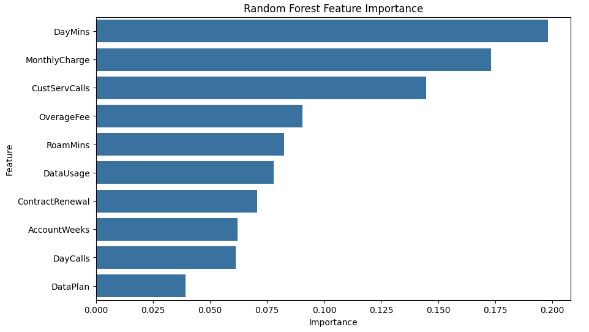
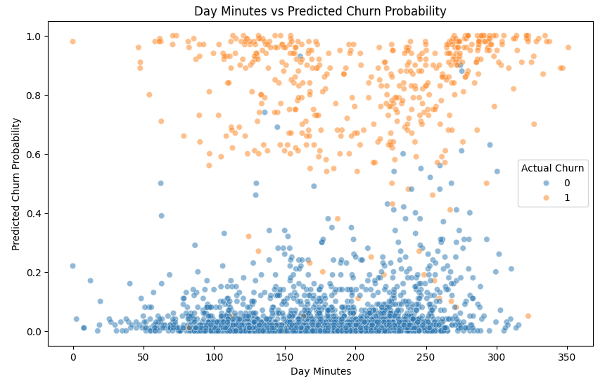

# Telecom Customer Churn Prediction

## Project Overview 

Customer churn is a key business challenge for telecommunications companies, leading to lost recurring revenue and reduced customer lifetime value. Identifying customers at risk of leaving can help move from reactive retention efforts to more targeted, proactive interventions.

This project uses exploratory data analysis and machine learning models to identify churn patterns, predict customer attrition, and inform targeted retention strategies.

## Business Problem

The business needs to identify which customers are most likely to leave, understand the factors associated with churn, and execute retention efforts accordingly. Without a reliable way to assess customer risk, retention campaigns may be applied too broadly, wasting resources on customers who are unlikely to leave while missing those who need intervention.

This project addresses the problem by comparing classification models to predict customer churn, evaluating their performance, and identifying higher-risk customer groups to support targeted retention strategies.

## Project Approach

- **Exploratory Data Analysis:** Examined customer usage, charges, service interactions and account characteristics to identify patterns associated with churn.
- **Data Preparation:** Assessed data quality, standardised numerical features and prepared training and test datasets.
- **Predictive Modelling:** Built and compared Logistic Regression, Random Forest and XGBoost classification models using accuracy, precision, recall, F1-score and ROC-AUC.
- **Model Interpretation & Risk Segmentation:** Used feature importance, odds ratios and SHAP analysis to interpret model predictions and identify higher-risk customer groups.
- **Business Recommendations:** Translated the findings into actionable retention strategies, including proactive contract renewal, targeted plan recommendations and risk-based customer service interventions, to help identify at-risk customers.

## Key Results

### Model Performance

Three classification models were evaluated using accuracy, precision, recall, F1-score and ROC-AUC. Random Forest achieved the strongest overall balance across these metrics.

| Model | Accuracy | Precision | Recall | F1-Score | ROC-AUC |
|---|---:|---:|---:|---:|---:|
| Logistic Regression | 85.76% | 52.63% | 20.62% | 29.63% | 80.91% |
| **Random Forest** | **92.50%** | **82.19%** | 61.86% | **70.59%** | **86.32%** |
| XGBoost | 91.75% | 75.61% | **63.92%** | 69.27% | 82.49% |

Random Forest was selected as the final model for its overall performance, although XGBoost achieved slightly higher recall.

### Key Churn Indicators

*Figure 1: Random Forest feature importance.*

Daytime usage, monthly charges and customer-service interactions were the three most influential features, collectively accounting for approximately 51.6% of the Random Forest model's feature importance.

### High-Risk Customer Groups

- **Contract renewal:** Customers without contract renewal had an average predicted churn probability of **13.86%**.
- **Product-plan opportunity:** High-usage customers without a data plan had an average predicted churn probability of **9.31%**.

*Figure 2: Daytime usage versus predicted churn probability.*

Higher daytime usage was generally associated with a greater concentration of elevated churn-risk predictions. However, customers with similar usage levels could receive different predictions, indicating that churn risk depends on multiple customer characteristics.

These findings support targeted contract-renewal engagement and assessment of suitable data plans for high-usage customers.
